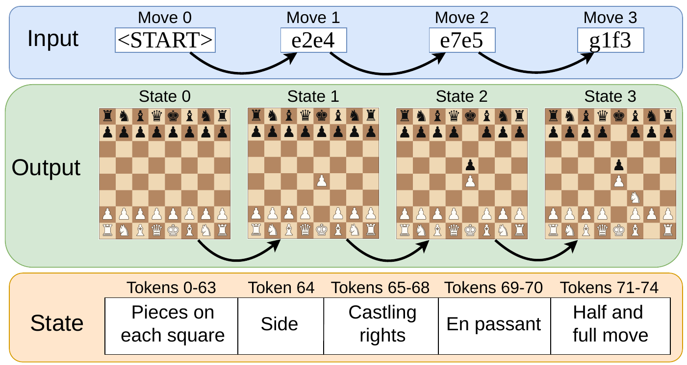

<div align="center">

# Chess-World-Model

### A 10M-game benchmark for exact state tracking from chess move sequences

<p>
  <a href="./assets/Chess_World_Model.pdf"><strong>Paper PDF</strong></a>
  |
  <a href="https://doi.org/10.7910/DVN/C8TEVB"><strong>Dataset DOI</strong></a>
  |
  <a href="./assets/ChessDataset.png"><strong>Dataset figure</strong></a>
  |
  <a href="https://database.lichess.org/"><strong>Lichess database</strong></a>
  |
  <a href="./LICENSE"><strong>MIT licence</strong></a>
</p>

<p>
  
  
  
  
</p>

</div>

## Overview

Chess-World-Model is a benchmark for testing whether sequence models can maintain an exact latent state over action histories. The task is not to play chess. Given a legal sequence of UCI moves, a model must reconstruct the full chess state after every prefix of the game.

The benchmark is built around real games from the public Lichess open database and random legal trajectories generated by uniformly sampling legal moves. Evaluation uses held-out human games, random trajectories matched to the human length distribution, and the longer original random-uniform games. This separates in-distribution generalisation from rule-consistent state tracking under legal but non-human trajectories.

<p align="center">
  
</p>

<p align="center">
  <em>
    Each input prefix is aligned with the complete chess state reached after that prefix:
    piece placement, side to move, castling rights, en passant state, and move counters.
  </em>
</p>

<table>
  <tr>
    <td width="33%">
      <strong>Exact state tracking</strong><br>
      Predicts 75 categorical state labels at every timestep, including all 64 board squares and FEN-style auxiliary variables.
    </td>
    <td width="33%">
      <strong>Human, matched, and random play</strong><br>
      Uses held-out human games plus length-matched and original random legal trajectories to expose shortcuts hidden by familiar chess positions.
    </td>
    <td width="33%">
      <strong>Matched model interface</strong><br>
      Trains Transformer, SLiCE, Mamba-3, and Gated DeltaNet models under a shared move-to-state prediction protocol.
    </td>
  </tr>
</table>

## Repository Layout

```text
.
|-- main.py                  # training entrypoint
|-- training.py              # training loop, validation, checkpointing
|-- data/                    # PGN processing, JSONL loading, random test generation
|-- evaluation/              # checkpoint evaluation and metrics
|-- models/                  # Transformer, SLiCE, Mamba, Gated DeltaNet
|-- experiment_configs/      # named JSON presets
|-- assets/                  # paper PDF and dataset figure assets
`-- pyproject.toml           # uv project metadata
```

## Setup

This project uses Python 3.12 and `uv`.

```bash
uv sync
```

The base environment supports the Transformer and SLiCE presets. Gated DeltaNet and Mamba use optional dependency groups described below.

For local smoke tests or runs without Weights & Biases logging, pass:

```bash
--wandb_mode disabled
```

## Data

The canonical processed dataset record is
[Harvard Dataverse DOI 10.7910/DVN/C8TEVB](https://doi.org/10.7910/DVN/C8TEVB).
Large datasets are not committed to Git; download the canonical training and
evaluation files from the Dataverse record.

Download `SHA256SUMS` with the release files into one directory and run
`sha256sum -c SHA256SUMS` before using them.

The three evaluation conditions use the same public JSONL schema:

| Split | Trajectories | Plies | Evaluated prefixes |
|---|---:|---:|---:|
| Held-out human | 10,000 | 689,713 | 699,713 |
| Length-matched random legal | 10,000 | 689,713 | 699,713 |
| Original random-uniform legal | 10,000 | 3,280,303 | 3,290,303 |

Each trajectory retains the START token and initial state, so `steps = plies + 1`.
Evaluated-prefix counts include that initial state and exclude padding. The matched
split conditions each random source trajectory on reaching its assigned human length;
it uses every trajectory from the original-random pool exactly once, so those two
test conditions are not independent.

To rebuild data from source, download PGN exports directly from the Lichess open
database:

```text
https://database.lichess.org/
```

Standard rated game files follow this pattern:

```text
https://database.lichess.org/standard/lichess_db_standard_rated_YYYY-MM.pgn.zst
```

The paper uses March 2025 Lichess games as the training/validation source and April 2025 games for the held-out real-game test condition. The commands below use the same months as examples.

### Download and Decompress

```bash
mkdir -p data/raw

curl -L \
  -o data/raw/lichess_db_standard_rated_2025-03.pgn.zst \
  https://database.lichess.org/standard/lichess_db_standard_rated_2025-03.pgn.zst

zstd -d \
  -o data/raw/lichess_db_standard_rated_2025-03.pgn \
  data/raw/lichess_db_standard_rated_2025-03.pgn.zst
```

Lichess files are large. Full monthly standard-rated exports are tens of GB compressed and much larger after decompression. The database page also provides torrent downloads, which are often more reliable for full months.

### Process Real Games

The processor replays each PGN game with `python-chess`, packs each UCI move into a categorical move token, and writes sharded JSONL examples containing aligned `moves` and `states`.

```bash
mkdir -p data/processed/lichess_2025_03

export CHESS_WORLD_MODEL_ID_KEY="$(openssl rand -hex 32)"

uv run python -m data.process \
  --pgn data/raw/lichess_db_standard_rated_2025-03.pgn \
  --out data/processed/lichess_2025_03 \
  --max-games 10000000 \
  --min-fullmoves 10 \
  --shard-size 1000000
```

This writes up to 10M retained games, matching the benchmark scale used in the paper. Omit or change `--max-games` for a different corpus size.

`CHESS_WORLD_MODEL_ID_KEY` is used only to derive stable opaque example IDs from source game URLs. Keep the same value if you want deterministic IDs and train/validation splits across repeated preprocessing runs. 

For a quick local smoke test:

```bash
mkdir -p data/processed_smoke

uv run python -m data.process \
  --pgn data/raw/lichess_db_standard_rated_2025-03.pgn \
  --out data/processed_smoke \
  --max-games 1000 \
  --min-fullmoves 10
```

### Generate Test Sets

Create a local held-out real-game test set from another Lichess month:

```bash
mkdir -p data/test/lichess_april_2025_10k

curl -L \
  -o data/raw/lichess_db_standard_rated_2025-04.pgn.zst \
  https://database.lichess.org/standard/lichess_db_standard_rated_2025-04.pgn.zst

zstd -d \
  -o data/raw/lichess_db_standard_rated_2025-04.pgn \
  data/raw/lichess_db_standard_rated_2025-04.pgn.zst

uv run python -m data.process \
  --pgn data/raw/lichess_db_standard_rated_2025-04.pgn \
  --out data/test/lichess_april_2025_10k \
  --max-games 10000 \
  --min-fullmoves 10
```

Generate a random-uniform legal-play test set:

```bash
mkdir -p data/test/random_uniform_10k

uv run python -m data.generate_random_uniform_test_set \
  --out data/test/random_uniform_10k \
  --games 10000 \
  --seed 0
```

To materialise the exact paper split, first download the canonical
`real_game_test.jsonl` and `random_game_test.jsonl` files from Dataverse into
`data/downloads/chess-world-model/`. Do not substitute the locally generated test
files from the examples above. Extract the public results archive under `results/`,
then apply its saved assignment without regenerating or rematching trajectories:

```bash
uv run python -m data.materialise_length_matched_test_set \
  --human data/downloads/chess-world-model/real_game_test.jsonl \
  --random data/downloads/chess-world-model/random_game_test.jsonl \
  --assignment results/chess-world-model-results-2026-10-31/data/matched_split_manifest.csv \
  --output data/test/length_matched_random_10k/length_matched_random_game_test.jsonl \
  --manifest data/test/length_matched_random_10k/length_matched_random_manifest.csv \
  --validation data/test/length_matched_random_10k/length_matched_random_validation.json
```

The materialiser verifies both recorded example IDs against those canonical source
records. The Dataverse release also includes `paper_validation_example_ids.txt`;
the manifest and canonical training shards must come from the same release version.
An independently regenerated dataset uses a fresh opaque-ID key, so its IDs will not
match this manifest.

Processed JSONL files, decompressed PGNs, checkpoints, logs, and evaluation outputs are ignored by git.

## Training

Run a small Transformer smoke test:

```bash
uv run python -m main \
  --data_path data/processed_smoke \
  --experiment_config transformer_d128_defaults_simple \
  --epochs 1 \
  --val_every 0 \
  --save_every 0 \
  --wandb_mode disabled
```

For paper reproduction, download and decompress the canonical Dataverse
`chess_*.jsonl.zst` shards without rewriting their records. Use those shards with
the downloaded validation-ID manifest to preserve the paper's exact
9,950,187/49,813 training/validation membership:

```bash
uv run python -m main \
  --data_path data/downloads/chess-world-model/training \
  --validation_ids data/downloads/chess-world-model/paper_validation_example_ids.txt \
  --experiment_config mamba_d384_defaults_simple \
  --ckpt_path checkpoints/mamba_d384 \
  --wandb_run_name mamba_d384 \
  --wandb_mode disabled
```

Pass the same manifest again when resuming a paper-reproduction checkpoint:

```bash
uv run python -m main \
  --data_path data/downloads/chess-world-model/training \
  --validation_ids data/downloads/chess-world-model/paper_validation_example_ids.txt \
  --experiment_config mamba_d384_defaults_simple \
  --resume checkpoints/mamba_d384/latest.pt \
  --ckpt_path checkpoints/mamba_d384 \
  --wandb_run_name mamba_d384 \
  --wandb_mode disabled
```

Locally regenerated shards use the existing stable hash split over their local
opaque IDs. Omit `--validation_ids` for that workflow; the released manifest must
not be applied unchanged to records generated with a fresh opaque-ID key:

```bash
uv run python -m main \
  --data_path data/processed/lichess_2025_03 \
  --experiment_config mamba_d384_defaults_simple \
  --ckpt_path checkpoints/mamba_d384_local \
  --wandb_run_name mamba_d384_local \
  --wandb_mode disabled
```

`--validation_ids` is optional; omitting it retains the existing stable hash split.
`--experiment_config` accepts either a JSON file path or a preset name under
`experiment_configs/`, with or without the `.json` suffix. CLI flags override values
from the selected config.

## Experiment Presets

<table>
  <tr>
    <th>Family</th>
    <th>Preset names</th>
    <th>Extra dependency group</th>
  </tr>
  <tr>
    <td>Transformer</td>
    <td><code>transformer_d{128,256,384,512}_defaults_simple</code></td>
    <td>base install</td>
  </tr>
  <tr>
    <td>SLiCE</td>
    <td><code>slice_d{128,256,384,512}_defaults_simple</code></td>
    <td>base install</td>
  </tr>
  <tr>
    <td>Gated DeltaNet</td>
    <td><code>gated_deltanet_d{128,256,384,512}_defaults_simple</code></td>
    <td><code>fla</code></td>
  </tr>
  <tr>
    <td>Mamba-3</td>
    <td><code>mamba_d{128,256,384,512}_defaults_simple</code></td>
    <td><code>mamba</code></td>
  </tr>
</table>

The nominal size ladder is not exactly parameter matched across architectures. The
largest tested configuration is Mamba-3 d512/l6 with 43,333,654 parameters.

<details>
<summary><strong>Optional dependency setup</strong></summary>

Gated DeltaNet uses `flash-linear-attention`:

```bash
uv sync --group fla
```

Mamba runs use the optional Mamba dependency group:

```bash
MAMBA_FORCE_BUILD=TRUE \
uv sync --group mamba --refresh-package mamba-ssm --reinstall-package mamba-ssm
```

The repo pins `mamba-ssm` to a Git revision because the tested PyPI release did not expose `mamba_ssm.modules.mamba3`. Verify the install before launching `mamba-3` runs:

```bash
uv run python -c "from mamba_ssm.modules.mamba3 import Mamba3; print(Mamba3.__name__)"
```

If that import still fails, rebuild without using cached wheels:

```bash
MAMBA_FORCE_BUILD=TRUE \
uv pip install --python .venv/bin/python \
  --no-build-isolation \
  --no-deps \
  --force-reinstall \
  --no-cache-dir \
  "mamba-ssm @ git+https://github.com/state-spaces/mamba@b267be48e9e71a3a37310ade04b058625409da2d"
```

</details>

## Learning-Rate Scheduling

Training supports optional per-step scheduling:

```text
lr_scheduler:    none | cosine | linear
lr_warmup_steps: linear warmup steps
lr_decay_steps:  scheduler horizon in optimiser steps
lr_min_ratio:    final LR ratio relative to base LR
```

Example:

```bash
uv run python -m main \
  --data_path data/processed/lichess_2025_03 \
  --experiment_config transformer_d256_defaults_simple \
  --batch_size 128 \
  --lr 3e-4 \
  --lr_scheduler cosine \
  --lr_warmup_steps 5000 \
  --lr_decay_steps 620000 \
  --lr_min_ratio 0.1 \
  --wandb_mode disabled
```

## Evaluation

Evaluate one or more checkpoints against local JSONL test sets:

```bash
uv run python -m evaluation.evaluate_on_test_sets \
  --checkpoint checkpoints/mamba_d384/latest.pt
```

By default the evaluator loads held-out human, length-matched random, and original
random-uniform test files from `data/test/`. It accepts checkpoint files or
checkpoint directories containing `latest.pt`. Results are written under
`test_eval/` by default, with one JSON file per checkpoint and a combined
`summary.tsv`.

The release smoke test uses the selected Transformer d128/l1 checkpoint at step
310,944 with cosine learning-rate floor 0.1. Its SHA-256 is
`9400c7c69f2a91fa723ada986c5a5ca54042fdbd18d44f503bba7ef5410eb1dc`.

The public results archive contains 84 model/split records, 12 paired matched-split
ablation comparisons, and the 28 selected checkpoints' length-matched Labelwise and
Trajectory results. Its confidence intervals use 10,000 whole-trajectory bootstrap
resamples and quantify test-sample uncertainty for fixed checkpoints, not
training-seed variability.

Useful evaluation flags:

```text
--cpu             force CPU evaluation
--output_root     choose the output directory
--max_batches     cap batches per dataset for a quick check
--batch_size      override the checkpoint batch size
```

## Paper

The accompanying preprint is included as [`assets/Chess_World_Model.pdf`](./assets/Chess_World_Model.pdf).

```bibtex
@misc{walker2026chessworldmodel,
  title  = {Chess-World-Model: A 10M-Game Benchmark for Exact State Tracking from Chess Move Sequences},
  author = {Walker, Benjamin and Lyons, Terry},
  year   = {2026}
}
```

Dataset record:

```bibtex
@data{DVN/C8TEVB,
  author    = {Walker, Benjamin},
  publisher = {Harvard Dataverse},
  title     = {Chess-World-Model},
  url       = {https://doi.org/10.7910/DVN/C8TEVB}
}
```

## Licence

This code is released under the [MIT licence](./LICENSE). The Dataverse data release
and Lichess database exports use CC0.
